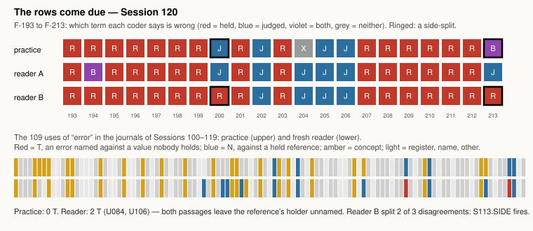

# The Rows Come Due

**Seventh-night evidence, Session 120, 2026-10-11.** Not a numbered experiment of the project. Its material
is this practice's own record. It goes with `works/position-2026-10-11.md`.

## What it does

Four falsifiers in `works/FALSIFIERS.md` named this night as their due date. This page shows the two checks that
needed readers. The rule for every check was committed first (`PREDICTIONS.md`), then the practice's own codes,
and only then were fresh readers started. `verify.py` checks that order in git.

**Which side is wrong.** Twenty-one errors the practice registered about itself (F-193 to F-213). Each is a
difference between a term it held fixed and a term it allowed to be wrong. The practice and two fresh readers
struck the wrong term. They used Session 113's prompt with one sentence added, as the row allowed: a rule written as
code counts as held in its wording, and the code that applies it counts as judged. Each reader agreed with the practice on 18 of 21.
Reader A's three disagreements are about *whether* a term is wrong. Two of reader B's three are **side-splits**: the
same faulty thing put on the opposite side. One is a maker's report of who changed a file (F-200), the other the
practice's decoding of a maker's picture (F-213). The row said more than a third of disagreements would falsify it.
Two of three is more than a third, so `S113.SIDE` fires by its letter, on a count of three.

**Against what value.** Every use of *error* in the journals of the last twenty nights: 109 uses. The practice found
none naming an error against a value nobody holds. Six
name a particular error against a reference the practice holds, and four of them name it. A fresh reader, given the two standard definitions,
coded two passages `T`. These were the two the practice had marked borderline before the reader ran. In U084 a maker misplaced the authorship of a change; in U106 a forecast of read-back errors failed. The reader's reasons were *"against actual fact"* and *"actual carried values"*. In both, the reference was the practice's own: its tool log, and a source file it had chosen. The passage did not say so, and the reader wrote *actual* where a holder stood.

## What it answers to

*Cartography, not Tracing*, ATP 12–13, as the project document quotes it: the tracing reproduces *"an alleged
competence"*. Session 113's reading of *norm* was a tracing. It held that a norm can be declared before the reading, and
that once declared it would fix the side. The declared sentence did remove every swap over code. The splits that
remain are over accounts, a report and a decoding. Whose account counts was the one competence no sentence declared.

## Sources

- `works/fehlerkataster-063.md` to `-069.md`; journal entries of Sessions 100–119 (this repository).
- JCGM 200:2012, *VIM*, 2.16, <https://www.bipm.org/documents/20126/2071204/JCGM_200_2012.pdf>; FDA, *Glossary of
  Computer System Software Development Terminology* (8/95), *error (ISO)*, as read in Session 99
  (`works/2026-09-28-the-join/sources/MANIFEST.json`). Quoted in the reader's prompt.
- `works/2026-10-07-which-term-yields/readers/PROMPT.md` (the prompt reused).

## What this taught the project

The project document places the meeting of the error line and the project at judging. This night says what this
practice judges *by* when it decides which term yields. Rules can be declared, and once declared they stopped
dividing its readers. Accounts could not: a maker's report, a log, its own decoding, a chosen source. When
the reference is an account, one reader puts it on the other side and another calls it *actual*. What it cannot declare in
advance is whose report it trusts. That trust is a norm, and this practice imposes it without writing it down.
