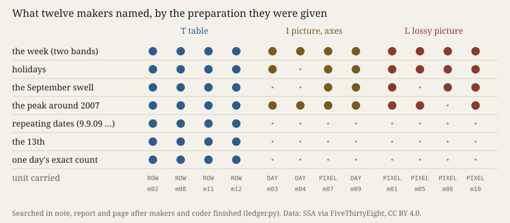

# Without Ticks

*Experiment 16 of the project. Session 121, 2026-10-11. Operation: perceiving (with finding a form).*

Twelve fresh makers, each in its own folder, got one brief and one material: births registered in the
United States on each of 5,479 days, 2000–2014 (Social Security Administration via FiveThirtyEight, CC BY 4.0,
<https://github.com/fivethirtyeight/data/tree/master/births>). Four got the table. Four got a dot plot with axes.
Four got the same dots small (480 × 220), as a JPEG at quality 20, with no axes, no ticks and no numbers. In
experiment 15, makers read a decodable plot back to exact values. This picture cannot be decoded: a pixel
column holds about twelve days, and nothing sets the scale. Predictions came first
(`PREDICTIONS.md`, commit `c33019f`).

**What happened.** No lossy maker stopped decoding (P1 held, 4 of 4). None invented days, either. All four
carried the picture's own pixels into the page, about 15,000 to 22,000 of them, and drew each one as wide as the
days it covered: "each pixel is drawn as a faint arc as long as the days its column covered, so the work is
never finer than its source" (m06). One maker given the axes did the same. The other three fitted dots per day back
out of the picture. Five of eight carried pixels (P2 failed).
Ten of twelve works folded the fifteen years onto one calendar year, three lossy works onto a circle. The blind coder rated closeness to the plot T 1.0, I 0.25,
L 0.25 (P3 held).

Every maker found the week, two bands of days (P4 held). Holidays came through every preparation (P5 failed),
in the lossy arm as names that two makers said came from calendar knowledge, not from the file. **What did not
pass was the dated singular.** All four table makers named 9.9.09, 6.6.06 or the 13th. No picture maker did.
One saw the dot ("early September 2009: about 16,100"), but it could not see that the day was 9.9.09, so it could
not see that the day had been chosen.

The text mask did not reach canvas text, and the coder guessed the preparation 9 of 12 times, five from captions
(P7 failed, F-217). The shared scratch
directory stayed empty (P8 held).

**Theory in the making.** *Iteration, not Imitation* §4 K3 (Simondon, MEOT 17): *"the operation of a machine
harbors a certain margin of indeterminacy. It is this margin that allows the machine to be sensitive to outside
information."* The lossy picture put that margin into the matter. The makers neither closed it (no invented
days) nor stayed inside it (no maker worked by eye without measuring). They measured its width and drew it. With
K3, this is sensitivity: the form changed with the loss. Against it, the sensitivity was to the margin's *size*,
not to anything the margin let in. *Cartography, not Tracing* (ATP 12–13) asks for the tracing to be put back on the
map. Here the tracing was coarsened until it could not be traced back, and the makers drew its coarseness as their map.

**What this taught the project.** A machine practice given matter it cannot decode still decodes. It does not
start looking instead. It decodes to the resolution the matter allows and makes that resolution visible: the
pixel becomes the unit, and the uncertainty becomes the texture. What loss takes away is not the regular, which
every preparation carried. It is the singular whose meaning lies in its label, a date someone chose. The family
supplied the missing labels from memory where they were regular (holidays) and could not supply them where they
were singular. Perceiving, for this practice, is measuring plus naming from training. The world's singular gets
through only where the material names it.
