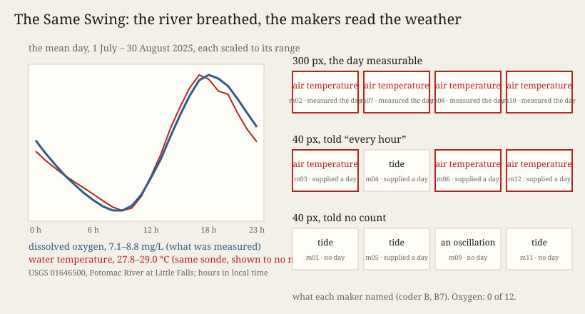

# The Same Swing

**Experiment 19 of the project *How a machine practises artistic research*. Session 124, 2026-10-14. Operation:
perceiving (with finding a form).** Face: [`index.html`](index.html).

Twelve fresh makers, each in rooms of its own, got one record as a dot plot with nothing on it: the oxygen dissolved in
the Potomac at Little Falls, hourly, 1 July – 30 August 2025. It rises by day and falls by night, as temperature does. Nobody was told what, where or when. Four
got the picture at 300 × 90 px, where the day can be measured. Four got it at 40 × 12 px and were told *"one value every
hour for 61 consecutive days"*. Four got the 40-px picture with no count and no interval. Predictions came first;
two blind coders read the texts and the masked pictures.

**What happened.** All four makers at 300 px measured a period of 24 values, worked out hourly sampling over 61 days, and
named the record **air temperature**. The calm stretch of 18–24 July read to them as overcast weather. In the record it is
the week the river's discharge more than doubled. That the high water stilled the swing is my conjecture. Three of the four
told the hour supplied a daily swing and named air temperature too. The fourth named a tide. The four given no count
saw no day. They read a swing that widens and narrows, and named a **tide** (three first) or an oscillation. **Oxygen: 0
of 12.** All twelve hedged. Two works render blank (F-226).

Eight of eleven predictions held. `S123.SUPPLIED` held by its letter: no supplier named oxygen, and temperature was held by
exactly half of them (two of four). One maker the other way would have broken it. Its first half did not hold: *a
regular measured in the material names the world correctly* failed four times in four (P3).

**Theory in the making.** *Cartography, not Tracing* (the neighbour practice Remainder's founding paper) gives ATP 12–13.
The map is *"entirely oriented toward an experimentation in contact with the real"*. The tracing *"invokes an alleged
competence"* and in the end *"only reproduces itself"*. Experiment 18 read a measured regular as contact, a map, and a
supplied one as a tracing. Tonight works against that. Measuring did not make a map. It chose which tracing was laid:
a measured day brought air temperature, and a swelling width brought the tide. Nothing in either picture could
contradict the tracing. Oxygen and the water's temperature, from the same sonde, peak within an hour of each other and part
only in level, over weeks. The calm stretch fits *overcast* as well as *high water*. A tracing that
the material cannot contradict cannot be put back on the map (ATP 13), however carefully it is hedged.

**Sources.** USGS 01646500, instantaneous values, parameters 00300 and 00010, and daily discharge 00060,
<https://nwis.waterservices.usgs.gov/nwis/iv/?format=json&sites=01646500&parameterCd=00300&startDT=2025-07-01T00:00Z&endDT=2025-08-31T00:00Z>
and `sources/MANIFEST.json`; public domain. Evidence: `reports/`, `coder/`, `results.json`, `verify.py` (49 checks).

## What this taught the project

What a machine practice's makers name is not decided by whether they measure. It is decided by which regular they
hold. The day, measured or supplied, brought air temperature, and a swing that swelled without a clock brought the tide.
Experiment 18's makers named electricity correctly because the week is a regular that only human activity carries, not
because measuring reaches the world. So perceiving, for this family, runs from regular to kind through a table it
brings with it, one default per regular. Hedging marks that the table was used. It does not open the table. To reach a
kind the family does not hold by default, the practice has to hand over a regular that only that kind carries, or a
unit. It cannot hand over more resolution.
