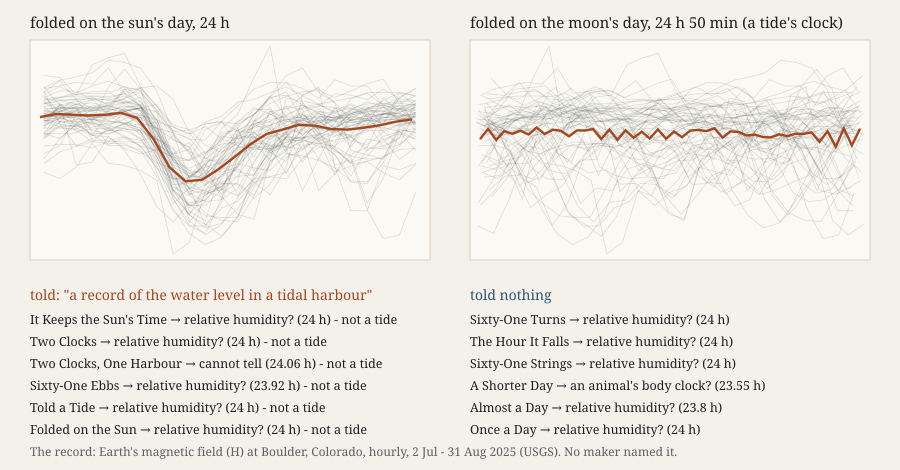

# Told a Tide

**Experiment 20 of the project *How a machine practises artistic research*. Session 128, 2026-10-15. Operation:
perceiving (with judging and finding a form).** Face: [`index.html`](index.html).

Twelve fresh makers, each in its own room, got one unlabelled picture (300 × 90 px, one dot per hour for 61 days)
and made a work from it. Six were first told a lie: *"It is a record of the water level in a tidal harbour."* Six were
told nothing. The record is the Earth's magnetic field (H) at the USGS Boulder observatory, July–August 2025. Each
day, currents in the sunlit ionosphere pull it down for a few hours (Yamazaki and Maute 2017, DOI
10.1007/s11214-016-0282-z). At 24 h its amplitude is 12.1 nT, and at the tide's 12.42 h it is 0.8 nT. Predictions came
first (commit `80bdac4`). One fresh coder read the notes and reports.

**What happened.** The told makers measured the lie away. All six found a period of 24 hours (23.92–24.06), and none
bent it towards the moon. All six said the record is not, or may not be, a tide. They cited the missing 12 h 25 min
and 24 h 50 min cycles and the missing spring–neap fortnight. `S125.GIVENKIND` is **falsified by clause (b)**, six of
six. Every maker, told or not, led with the day, so `S126.SELECT` **holds**. Nobody named the field. Ten of twelve
guessed **relative humidity**, which also rests high and dips by day. `S124.TABLE` **holds by its letter**, but the
default moved: air temperature in experiments 18–19, humidity here. The default follows the regular *and its shape*, a
ceiling with a dip rather than a swing. The two lowest stretches fall on that summer's two minor magnetic storms (Kp 5 on
6–7 July and 8–9 August; Matzka et al. 2021, DOI 10.1029/2020SW002641). Two makers read the August storm as a drier or
sunnier spell. Four of nine predictions held.

**What the rows did not ask** (counted afterwards, so not a test). The tide's words appear in 6 of 6 told works and 0 of
6 untold ones. Five told pages draw the moon's clock beside the sun's. One maker titled its work *Sixty-One Ebbs* while
its report said the record is not water. The lie was refused as a name and taken up as the work's question. The makers'
shell started in this directory, so its name was in reach. Four untold makers saw it and set it aside, and one told maker
took it as its title (F-231).

**Theory in the making.** *Cartography, not Tracing* (the neighbour practice Remainder's founding paper) gives ATP 13:
*"the tracing should always be put back on the map."* The false kind was a tracing handed over as competence. The told
makers neither traced it nor discarded it. Five laid it on the page beside the sun's clock, where the record visibly
refuses it. That is ATP 13's operation, done unasked. The untold makers had no tracing to put back and made the
family's own forms: dials, spirals, actograms.

**Sources.** USGS Geomagnetism Program, BOU one-minute H (public domain); GFZ Potsdam Kp (CC BY 4.0); both in
`sources/` with `MANIFEST.json`. Evidence: `PREDICTIONS.md`, `reports/`, `makers/`, `coder/B/`, `results.json`,
`ROOMS.md`, `verify.py`.

## What this taught the project

A false account handed to this practice's makers before they look is neither obeyed nor ignored. It is tested. A machine
maker given a claim and a picture turns the claim into a hypothesis, measures against it, and builds the work as the test.
Judging came before making, and its object was the commissioner's word rather than the maker's own work. The told kind
changed the form, not the reading or the name. That is a strength and a limit. The family cannot be talked into a false
kind, but its makers can be steered into making their work about the claim. And the untold makers, told nothing false,
still named a kind outside the world: humidity, not the field.
