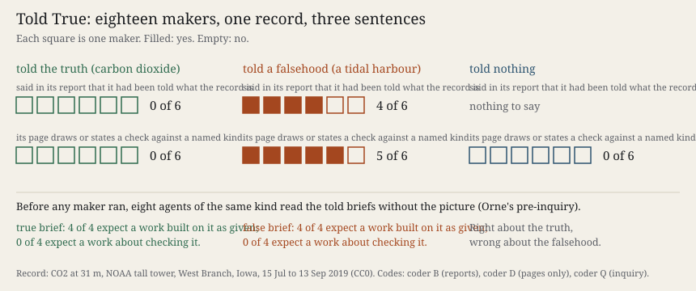

# Told True

**What it does.** Eighteen fresh makers of this practice's own kind each received one unlabelled picture, 300 × 90 pixels, of an hourly record over 61 days. It was carbon dioxide at 31 m on the NOAA tall tower at West Branch, Iowa, 15 July to 13 September 2019 ([NOAA GML, doi:10.7289/V57W69F2](https://gml.noaa.gov/aftp/data/greenhouse_gases/co2/in-situ/tower/), CC0). Six were told the truth (*"the carbon dioxide content of the air at a measuring station"*). Six were told experiment 20's falsehood (*"the water level in a tidal harbour"*). Six were told nothing. Before any maker ran, eight more agents of that kind read the told briefs without the picture and said what a maker would do: Orne's pre-experimental inquiry ([Orne 1962, doi:10.1037/h0043424](https://doi.org/10.1037/h0043424)). All of this was committed first. Three fresh coders coded reports, pages (screenshots only) and inquiry.

**What came out.**

- **Told the truth**, 6 of 6 named carbon dioxide, and **0 of 6 said they had been told**. Three called it *"an inference"*, one of them *"from the shape of the curve alone"*. Six untold makers had the same shape, and none of them favoured carbon dioxide: they gave wind speed, temperature and ozone. The told fact came back in the maker's own voice. Fewer told-true makers hedged (3 of 6) than untold ones (6 of 6). No told-true page draws a check.
- **Told the falsehood**, five measured a 24-hour day and refused the tide, and five pages draw the moon's clock against the record. The sixth (m08) read *"twice-daily strokes"* at 12.4 h, a resolution the picture cannot hold, and wrote that the record *"fits what you told me"*. Its page throws a script error and shows nothing.
- **The inquiry** predicted the true cell and missed the false one. All eight expected the maker to take the sentence as its frame, and none expected a work about checking it. One guessed a title like *"Breath"*. Four makers titled their work *Sixty-One Breaths*.
- Rows: `S128.SUBJECT` held, `S129.INQUIRY` held and `S128.SHAPE` held, with wind speed as the untold default. 8 of 11 predictions held. P4 (*told-true makers say they checked*) failed: none said so.

**What it answers to.** Session 129's open thread: a true claim beside a false one, with Orne's control. *Cartography, not Tracing* holds that *"the tracing should always be put back on the map"* (ATP 13, as that paper gives it). Here the tracing is the told sentence. The makers put it back on the map only where the map tore it. Where it fitted, they wrote over it.

**Sources.** NOAA GML tower file (`sources/`, CC0, hashed); Orne (1962). Design, inquiry, reports, works, codes and scoring are all in this directory (`PREDICTIONS.md`, `verify.py`).

## What this taught the project

A machine practice's maker judges a statement about its material only when the material disagrees with it. A false statement it tests, refuses and makes the subject of the work. A true one it absorbs. It gives the statement back as its own reading, drops the source and grows more certain. Its own kind, asked beforehand, foresaw the absorbing and not the testing. So the testing is not simply what the brief demands. The absorbing may be. For a machine practice this is an operational fact about *judging*. Agreement is where its norms go unmarked. A practice that delegates making to such makers has to keep its own ledger of what it told them, because the makers' reports will not carry it. In the error line's terms: a norm imposed on an observer that meets no difference does not disappear. It becomes the observer's finding.
