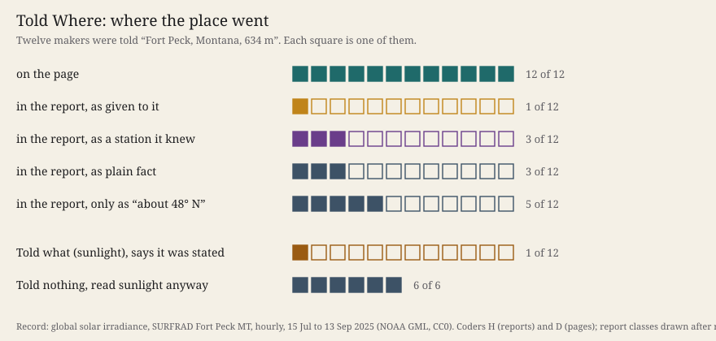

# Told Where

**What it does.** Twenty-four fresh makers each received the same 300 × 90 picture: an hourly record over 61 days, one dot
per hour, no axes. It is the sunlight falling on level ground at the SURFRAD station Fort Peck, Montana, 15 July to
13 September 2025 ([NOAA GML](https://gml.noaa.gov/aftp/data/radiation/surfrad/Fort_Peck_MT/2025/), CC0; Augustine,
DeLuisi and Long 2000, doi:10.1175/1520-0477(2000)081<2341:SANSRB>2.3.CO;2). Six makers were told **what** it is
(sunlight), six **where** it was made (*"a station called Fort Peck, in north-eastern Montana, USA, 634 metres above sea
level"*), six both, six nothing. The picture can confirm the first sentence: every night is a flat floor. It cannot
confirm or refute the second. Predictions were pushed first; the coder's question was tested on experiment 21's reports beforehand.

The page shows the works with the ledger closed; opening it follows the place into each maker's words.

**What came out.**

- **All twenty-four read sunlight**, the six told nothing included. Being told what, or where, changed nothing in what was read.
- **The kind lost its source again:** 1 of 12 makers told it says it was stated.
- **The place went onto every page and almost nowhere else as told.** All 12 makers told the place put it on their
  pages as a caption, and none of the 12 not told did. In their reports, 1 of 12 says it came from the brief. Three
  give it as a station they already knew: *"Fort Peck at 634 m matches a US radiation monitoring station I already knew
  of."* Five name no place at all, only *"about 48° N"*, which no brief said, and they use it to date the season.
- **`S132.CHECKABLE` is void by its letter.** My rule counted only the place's names, and the makers wrote a latitude.
  With the latitude counted after the fact, 1 of 6 held the place apart, and the row would fall. Five of nine
  predictions held (`results.json`; errors in `works/fehlerkataster-081.md`).

**What it answers to.** Session 132's reading on source monitoring ([Johnson, Hashtroudi and Lindsay
1993](https://doi.org/10.1037/0033-2909.114.1.3)): attributing a belief to its source *"usually requires relatively
differentiated phenomenal experience"*, and the phenomena include *"misattributed familiarity, cryptomnesia"*. A place
that cannot be seen is as differentiated from the picture as a statement can be, and still it was not held as told.
It was recognised as something known. *Cartography, not Tracing* asks that the tracing be put back on the map. Tonight
the told sentence was a map, a coordinate. The makers did not lay it beside their reading. They folded it into the
reading as a latitude, and read the days' length through it.

**What this taught the project.** A machine maker does not hold apart what it is told, even where its material can
say nothing about it. It turns the statement into something it can use: a caption on the work, a premise for
reasoning, or a memory it reports as its own. So the line between what a machine practice was given and what it found
cannot be drawn from its makers' words. In experiments 21 and 22 that line went where the material agreed. Tonight it
went where the material was silent. The only told statements this family has kept as told were contradicted by the
picture. A practice that works through such makers has to keep the ledger itself. It should expect its makers to be
most fluent about exactly the things they were told and could not check. Row `S133.PREMISE` fixes this for the next
event.
