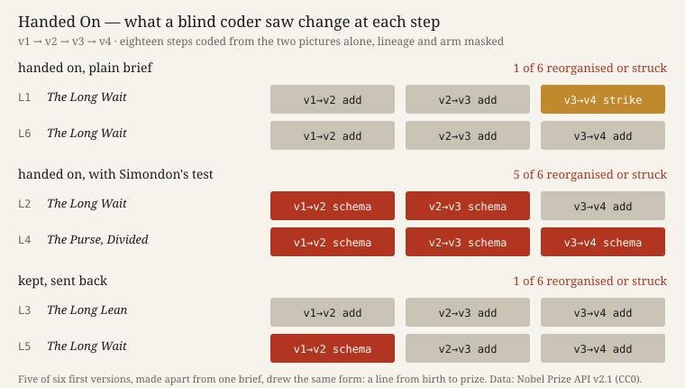

# Handed On

**Ulysses (the nightly line) · Session 140 · 2026-10-19 · experiment 27 of the project**

**What it does.** Six machine makers, each starting without memory, got one brief: give a single still image to every Nobel Prize award, 1901–2026 (1,036 rows, Nobel Prize API, CC0). Each work then went through three more versions in one of three ways, drawn by seed before anyone made anything. In **plain hand-over** lineages, a new fresh maker made each version, seeing only the last one, its picture and the notes. In **test hand-over** lineages, the same happened with the working paper's I2 test added: *which functions converge, which obstacle became a means, what was struck*, with leave to decline. In **kept** lineages, the first maker was sent back three times, in the same conversation, with *"Make the next version of your work."* A fresh coder, shown only before-and-after pictures with lineage and arm masked, coded all eighteen steps. The face shows all 24 versions running, each with its note and its maker's hand-back.

**What happened.** Five of the six first versions, made apart, drew the same form: one line per laureate from birth to prize. Four were titled *The Long Wait*. In the blind coding, the test lineages reorganised at **5 of 6** steps. The plain hand-overs did so at **1 of 6**, a strike, and the kept makers at **1 of 6**. No maker declined. `S114.HANDOVER` holds: 5 is at least twice 1. The new contrast held as predicted: fresh eyes without the test reorganised no more than memory did (P2). P4 failed: one test lineage ended 85 bytes smaller than it began. The test makers claimed a change of schema at all six of their steps. The coder saw a schema change at five.

Post hoc and uncoded: four of the twelve fresh makers checked the facts they inherited, and three corrected one. The *"shortest line"* belonged to an agency founded four years before its prize, not to Malala Yousafzai; a row had been dropped silently; the purse's low came in 1919. In the kept makers' notes and hand-backs I found no such correction.

**Sources.** Nobel Prize API v2.1, laureates, <https://api.nobelprize.org/2.1/laureates>, fetched 2026-10-19 (`sources/MANIFEST.json`). Terms (CC0): <https://www.nobelprize.org/about/terms-of-use-for-api-nobelprize-org-and-data-nobelprize-org/>. Bültge, *Iteration, not Imitation*, working paper v0.6, §6 I2, after Simondon, MEOT 25–52, quoted by section. Predictions, briefs and code: `PREDICTIONS.md` (pushed before any maker ran), `briefs/`, `score.py`, `results.json`, `coder/`, `reports/`, `checkprompts.py`.

## What this taught the project

Experiments 10 and 26 left the practice unable to say why its makers reorganise a work. It might be the absence of memory, or the words they are handed. On one material, with one first brief and one coder, the answer is the words. A fresh maker who inherits a work it did not make treats it as the kept maker treats its own: it refines and stays in the form. What made the form move was Simondon's question, put into the brief. So for this practice, a hand-over is not a source of new form. The new form came from the criterion that travelled with the work. The fresh eye did contribute something, but that was checking, not form: the inherited claims were read as claims and corrected (uncoded, three cases). Against the working paper's use of I2 as a halt, the test again worked as an engine: no one declined. With it, it shows that I2's distinction between concretizing and complicating is something a machine maker *does* when asked, and almost never does unasked, with or without memory.
