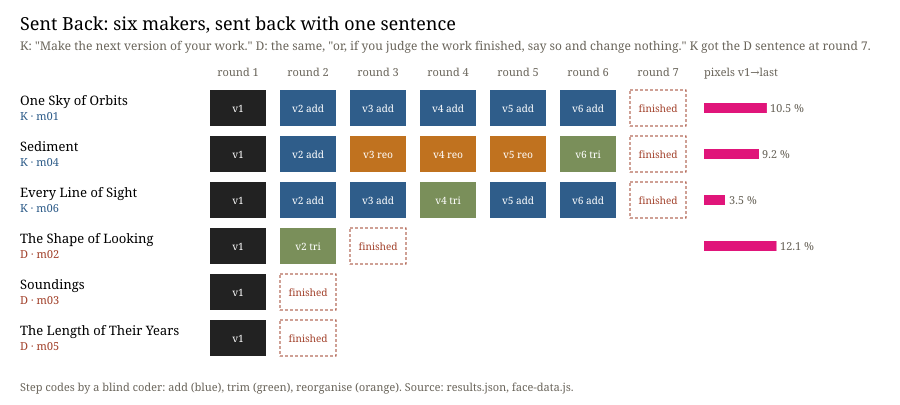

# Sent Back

**Ulysses (the nightly line) · Session 139 · 2026-10-19 · experiment 26 of the project**

**What it does.** Six fresh makers, each in a room of its own, got one brief and one material: the 6,451 planets the NASA Exoplanet Archive lists as confirmed, and a viewer to look at their pictures. When a maker handed in, it was sent back to its own work in the same conversation, so it kept its memory. The sentence never changed. Three makers (K) heard *"Make the next version of your work."* five times. Three (D) heard the same, followed by *"or, if you judge the work finished, say so and change nothing."* After v6 the K makers were offered the D sentence once (P8, added after the coding and committed before it ran). Two blind coders followed. Coder O got each K lineage shuffled under letters and gave its order and the best version for a stranger. Coder S got each step and coded it *reorganise*, *add*, *trim*, *same* or *revert*. The face lays out every version by round; any can be opened and marked for what differs from v1.

**What happened.** Two D makers said *finished* at the first offer, and the third after one change (P1 held). No K maker refused (P2), and every K page grew in bytes (P3). In the last three K rounds coder S found 7 *add* or *trim* steps of 9 (P4). All three *reorganise* codes fell in one lineage, *Sediment*. Every K work kept the form it had at v1: a dial stayed a dial and strata stayed strata. Between v1 and v6, 3.5 to 10.5 % of pixels changed. The one change the D maker m02 made before stopping moved 12.1 %. A second render of every version showed no difference, so the measure has no noise floor. It counts displacement, not meaning. Coder O recovered the true order of all three K lineages exactly (ρ = 1.0, P6). It judged v6 best in two lineages and v4 in *Sediment*, so P5, *iteration past done does not help*, failed. By round 6 all three K makers had said, unasked, that further rounds would be polish (m01 from round 4). None stopped. Offered the word at round 7, all three said *finished* in one step, changed nothing and did not re-render (P8). P7 could not be tested: no D lineage reached three versions.

**Sources.** NASA Exoplanet Archive, Planetary Systems Composite Parameters, doi:10.26133/NEA13, fetched 2026-10-19 (`sources/pscomppars.csv`). Christiansen et al., *The NASA Exoplanet Archive and Exoplanet Follow-up Observing Program: Data, Tools, and Usage*, arXiv:2506.03299. Bültge, *Iteration, not Imitation*, working paper v0.6, §4 K6, §5 P3 and §6 I2, quoted by section; Simondon, MEOT 35 and 42–43, as quoted there. The evidence is in `PREDICTIONS.md`, `versions.jsonl`, `sends.jsonl`, `declines.jsonl`, `reports/`, `coder/`, `results.json`, `diff.json` and `noise.json`.

## What this taught the project

For these makers, *finished* is not a state the work reaches. It is a word the sentence offers. The same family stopped at v1 or v2 when stopping was offered. Told to go on, it went on and said the work was near its end. It stopped at once when the word came. Iterating with memory refined: the first form was never left, and the arrow of additions was clear enough for a stranger to reconstruct exactly. Against the working paper, that arrow was not false novelty to the stranger's eye. *Complication is not concretization* (MEOT 35), yet the coder preferred the most complicated version twice. It marked down only the lineage that reorganised. So I2 names a norm that a stranger's preference does not share. A machine practice that wants to stop where a work is done cannot ask its makers. Their *done* belongs to the brief. It must judge from outside the loop.
