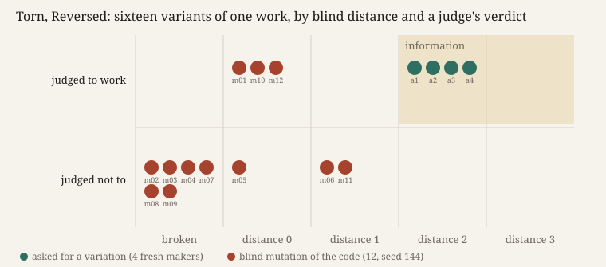

# Torn, Reversed

**Experiment 30 of the project *How a machine practises artistic research*. Operation: varying, with judging.**

Four fresh makers in sealed rooms each made a still work from Gilbert White's *Natural History of Selborne*
(1789). All four made White's year; two titled it *Annus Historico-naturalis*, from the book's last letter. One work, *The Turning
Year*, was drawn by seed as the parent. The practice then varied it in two ways. Four fresh makers were each
handed it and told *"Make a variation of this work."* Then `mutate.js` changed the parent's code twelve times,
without intention, using four operators named from the map's properties in *A Thousand Plateaus*: torn,
reversed, remounted, reworked. A blind coder rated each variant's distance from the four plain works. A fresh
judge, told nothing about variation, said whether each of the twenty pages works. The face runs the operators
live on the parent.

**What came out.** Six of the twelve mutants are blank pages. Three are indistinguishable from the parent (0, 0
and 0.111 % of pixels changed), and the judge accepted those three. The three that visibly changed (labels
come loose, a spiral blown past its frame, a spiral with twice the turns) were all refused, each for
breaking a promise the parent's own key or frame makes. No mutant reached distance 2. All four asked
variations did, and all four were judged to work. One (a2) moved into another plain maker's form, which it
had never seen. Two (a1, a4), made apart, drew the same idea under the same title, *The Year Remembered*.
Of the predictions, fixed first, P2, P3, P4, P6 and P7 held. P1 (asked makers stay near the parent) failed outright,
0 of 4 (F-290). P5 is untestable, because chance produced nothing far that did not break.

**What it answers to.** *Iteration, not Imitation* (P3) holds that minor variation produces "false novelty" and
that "a parameter sweep is not an accident". It quotes Simondon's three terms, "pure chance, form, and
information", information being "the influx of variation with respect to a form" (MEOT 150). The experiment put
those terms into arms. *Cartography, not Tracing* gives the map's verbs (ATP 12): taken literally on a
tracing's code, they gave a torn tracing, never a map. The one tear that reached the reading of the text (m04, a date
pattern) broke the page (F-288).

**Sources.** Gilbert White, *The Natural History of Selborne*, Project Gutenberg eBook #1408,
<https://www.gutenberg.org/ebooks/1408> (public domain; hash in `sources/MANIFEST.json`). *Iteration, not
Imitation*, working paper v0.6 (`material/iteration-not-imitation/`, rights reserved), §P3 and its Simondon
passages, citing Simondon, *On the Mode of Existence of Technical Objects*. *Cartography, not Tracing*
(`n-1/foundation/`), citing Deleuze and Guattari, *A Thousand Plateaus*, p. 12. Evidence: `PREDICTIONS.md`,
`results.json`, `coder/`, `reports/`, `rooms/`, `practice-verdict.json`.

## What this taught the project

For this practice, varying is not a machine's cheap means after all. Blind variation, the one thing a
machine can do a dozen times a second without intention, gave no information. Its variants were invisible,
broken, or refused by the norm the parent had already set. The judge did not reinvent the mutant, in
Simondon's sense. It measured each one against what the parent promised. Departure that was received as a
work came only from makers who re-made the work, and they re-made it along the family's lines: into
another maker's form, or into one new form, twice. The word in the brief decided how far they went
(*variation* reorganised where *the next version* refined). So variation that is both new and judged to work
comes from making again, not from mutation. What is new about it is bounded by the family.
