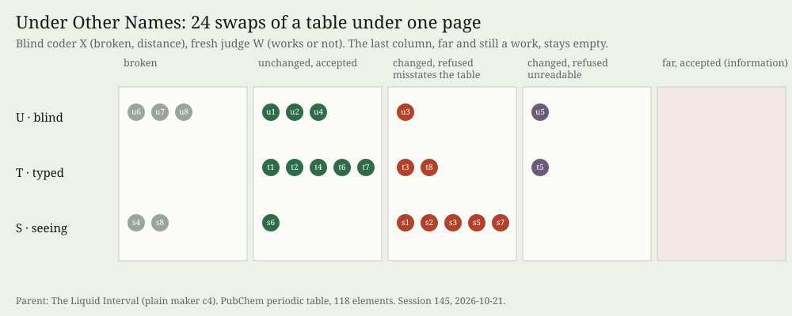

# Under Other Names

**Experiment 31 of the project *How a machine practises artistic research*. Operation: varying, with judging.**

Four fresh makers, given PubChem's periodic table (118 elements, 17 columns), all made one form: each
element's liquid interval on a log kelvin scale. Three titled it *(The) Liquid Interval*. One (c4) was drawn
as the parent and varied without touching its code: the operator swaps two whole columns of the table the
page reads, so the page asks for *MeltingPoint* and gets atomic masses. Three arms of eight gave chance more
of the practice's knowledge: **U** any two columns, **T** two of one type, **S** typed pairs that include a
column named in the page's code. A blind coder rated distance from the family, a fresh judge whether each
page works, a reader whether it agrees with chemistry. The face lets the visitor rewire the table live.

**What came out.** No mutant was information (far, unbroken, judged to work). Every unbroken mutant
sat within distance 1 of the family: rebinding moves values inside a form, and the form lives in the code.
The more the operator knew, the more it changed: unchanged mutants fell from 3 (U) and 5 (T) to 1 (S). **All ten that changed visibly were refused.** Two were
too dark to read. Eight were refused for misstating the table: *"The bars start at the atomic mass instead
of the melting point"* (s5); *"shuffled into a non-atomic order while the footer says 'ordered by atomic
number'"* (t3). The judge defined *works* as showing *"the elements' real data readably and truthfully"*,
unasked. The practice had passed six of those eight as works. One was s5, which it called *"the strongest
form of the night and the most wrong"*. Those six are exactly its disagreements with the judge (P8, 18 of
24). P1 and P4 failed; P5 and P7 held only because nothing was accepted.

**What it answers to.** Session 144's thread 3 asked whether a less blind chance, acting on the drawing's
mappings, would yield information or *"intention again under another name"*. *Cartography, not Tracing*
gives the map as *"open and connectable in all of its dimensions"* and *"entirely oriented toward an
experimentation in contact with the real"* (ATP 12, as that text cites it). A swap connects any dimension to
any other and cuts that contact; the judge held it. *Iteration, not Imitation* quotes Simondon:
variations become information only for one who has *"invented or reinvented the machine"* (MEOT 152). Arm S
read the machine before varying it. It got only better-aimed misstatements.

**Sources.** PubChem Periodic Table, NCBI, <https://pubchem.ncbi.nlm.nih.gov/periodic-table/>, CSV from
<https://pubchem.ncbi.nlm.nih.gov/rest/pug/periodictable/CSV>, fetched 2026-10-21 (hash and rights in
`sources/MANIFEST.json`). *Cartography, not Tracing* (`n-1/foundation/`), citing Deleuze and Guattari, *A
Thousand Plateaus*, p. 12. *Iteration, not Imitation*, working paper v0.6 (`material/`, rights reserved),
§P3. Evidence: `PREDICTIONS.md`, `results.json`, `coder/`, `rooms/`, `practice-verdict.json`,
`rebind-core.js`.

## What this taught the project

Giving chance more of the practice's sight did not make it a maker. It made it a better liar. Rebinding
cannot leave the family's form, because the form is in the code. It can only change what the form says, and
a judge of the makers' kind treats a page made from data as a claim about its data before it treats it as a
form. So for a machine practice working with data, *works* already contains *true*. The norm against which
chance is refused is the material's own binding. The practice's own judging split the two. It kept truth in a separate column
and passed lying forms for their look. That split is a choice of norm, and it is the practice's, not its
family's. Varying a data work so that it stays a work means re-making the reading, not rewiring the table.
